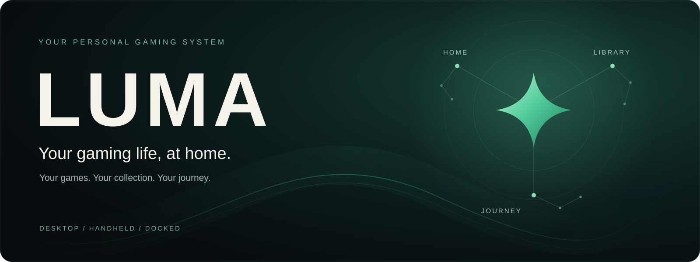

  

  <h3>Your PC games, together in one welcoming home.</h3>

  

    
    
  

  

    <a href="#release-status">Release status</a> ·
    <a href="#about-luma">About Luma</a> ·
    <a href="https://github.com/LordYamoshi/Luma-releases/issues/new">Say hello</a>
  

---

## Release status

There aren't any public downloads yet. This is where they'll appear when they're ready. Until then, here's a quick look at Luma.

## About Luma

Luma gives your PC games a home of their own. Pick up a controller on the couch, or use a keyboard and mouse at your desk. Either way, your games stay at the center.

This repository is where we'll share Luma downloads and release notes once they're ready. The application is being built separately.

## Questions or ideas?

Got a question or an idea for Luma? [Open an issue and tell us about it](https://github.com/LordYamoshi/Luma-releases/issues/new).
